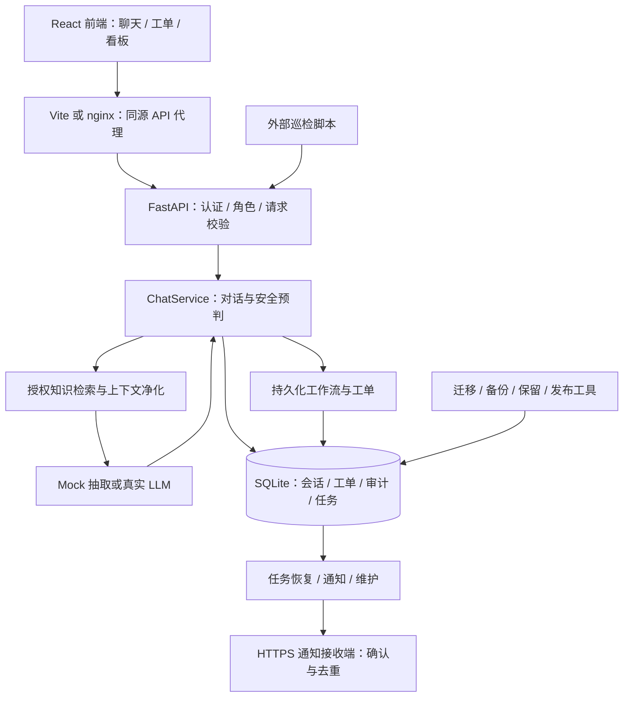

# ESAA 项目技术报告

> 2026-10-14 后续 [可执行验收结果](FINAL_ACCEPTANCE.md)：工程与实际容器浏览器/选定故障验收通过，并修复窄屏溢出。外部 API 按用户要求暂不接入；正式部署和独立审阅暂缓。冻结质量意图门禁仍未通过，完整方案未签收。下方数字为 2026-10-13 审查基线。

审查日期：2026-10-13（Asia/Shanghai）

代码基线：`main`，`037f180b39b7b6e9bca7c39a96150f68412bce9b`

需求依据：[PRODUCT_SPEC.md](../PRODUCT_SPEC.md)；后续完善依据：[IMPROVEMENT_PLAN.md](IMPROVEMENT_PLAN.md)。

## 1. 项目结论

ESAA 已形成可运行、可通过前端演示的企业安全知识助手原型。登录、角色授权、知识检索与引用、中文核心场景、意图和风险分类、多轮升级、工单、人工处理、统计与审计均已有实现及自动化证据。GitHub 的工程门禁和实际 Docker 核心验收通过；项目已通过 [PR #1](https://github.com/Ksanadu/enterprise-security-ai-assistant/pull/1) 合并到主分支。

当前适合离线演示、技术评审和受控环境下的后续开发。完整完善方案尚未签收：真实 LLM/Embedding 效果未验收，新的独立质量验收未通过，容器中的真实浏览器流程和正式部署运维仍需补齐。不能将测试数量、覆盖率或 Docker 核心脚本通过解释为生产可用证明。

| 维度 | 当前完成情况 | 判断边界 |
| --- | --- | --- |
| 原设计业务 | 中文 A/B/C/D 与钓鱼多轮升级等核心场景已实现并验证 | 使用模拟企业材料；自然语言覆盖仍需独立评测 |
| 前端可视化 Demo | 已具备真实后端驱动的聊天、引用、风险、工单、导览、看板和通知状态 | 默认是离线抽取式回答；部分界面仍为英文 |
| 工程质量 | GitHub 后端 1813 通过、前端 81 通过；后端覆盖率 94.89% | 对应明确代码版本，不能外推到未测环境或模型 |
| Docker | 两种配置下的实际构建、启动、代理、重启及关键故障检查通过 | 浏览器视觉、真实模型组合、部分容器故障尚未验收 |
| 真实模型 | OpenAI 兼容接口、预算、降级、评测工具已实现 | 当前没有真实服务验收报告 |
| 独立质量 | 冻结数据、阈值、首次失败和后续回归都已保留 | v1 已用于调优；最新回归仍未达到意图门槛 |
| 运维 | 迁移、共享限流、通知、巡检、备份恢复、账号、保留及本地回滚工具已实现 | 正式渠道、责任人、TLS 入口、政策和恢复目标未落地 |

## 2. 审查范围与证据方法

本次核对了 Git 跟踪清单、顶层本地文件、需求和阶段文档，并重点阅读了启动配置、API 权限、聊天管线、检索与生成、工单恢复、通知、共享安全控制、迁移、备份和保留逻辑，以及前端请求与状态管理、镜像、CI、评测和交付工具。测试目录用于核对功能契约、失败回归和验收边界。对于关键结论，同时比对源码、测试及实际执行记录。

这是一次工程审查与文档整理，不是外部渗透测试，也没有重新执行真实模型或容器浏览器验收。历史全量结果与本轮针对性验证分开记录。清理仅涉及确认无业务用途的系统文件、可再生缓存和已失效的旧解释器环境；没有更改业务逻辑或冻结评测数据。

审查前主分支有 **273 个跟踪文件**。以下统计包含各目录的跟踪文件；行数含注释、空行，前端目录含组件测试，不是纯生产代码规模：

| 目录 | 文件数 | 职责 |
| --- | ---: | --- |
| `backend/app/` | 81 | API、AI/RAG、安全策略、数据库及业务服务，约 1.66 万行 Python |
| `backend/tests/` | 59 | 测试、语料与原 40 题回归数据 |
| `backend/scripts/` | 9 | Demo、模型/质量评测、账号及保留等工具 |
| `backend/migrations/` | 7 | Alembic 环境、冻结基线和四个迁移版本 |
| `frontend/src/` | 31 | React 页面、组件、Hooks、客户端及测试，约 0.61 万行 |
| `scripts/` | 16 | 环境恢复、门禁、容器、巡检、备份、发布与交付 |
| `docs/` | 21 | 审查前的架构、演示、质量、阶段与运维材料 |

清单依据为本轮 `logs/project-review/source-inventory.json`。这些数量表示审查前的代码基线，不包含本报告和本轮文档更新。

## 3. 技术架构

### 3.1 技术栈与运行形态

| 层 | 实现 | 取舍 |
| --- | --- | --- |
| 前端 | React 18、TypeScript、Vite 6、Vitest | 严格类型；不持久化访问令牌；没有复杂 UI 框架依赖 |
| API | Python 3.12、FastAPI、Pydantic 2 | 明确请求/响应契约、统一错误和请求关联标识 |
| 存储 | SQLAlchemy 2、SQLite WAL、Alembic | 单机试点部署简洁；写入竞争和高可用需要另行验证 |
| 离线检索 | 中英文词项、BM25 加权 TF-IDF、FAISS；可回退内存向量存储 | 可复现、无需密钥；同义表达泛化受词项覆盖限制 |
| 生成/分类 | 确定性规则与 Mock 抽取；可配置 OpenAI 兼容服务 | 权限和升级由应用控制；真实模型效果独立验收 |
| 部署 | 双服务 Docker Compose、nginx 静态站点和 API 代理 | 单源访问；当前模板主要服务原型部署 |
| 工程门禁 | Ruff、mypy、pytest/覆盖率、tsc、ESLint、Vitest/覆盖率、秘密扫描 | 可自动阻止已覆盖的工程回归 |

Python 依赖使用版本区间，前端有 `package-lock.json`。`PHASE8_ENVIRONMENT.json` 是一次安装环境的记录，不能替代可移植、带摘要的后端依赖锁或镜像供应链证明。当前镜像基础标签也没有固定到 digest。

### 3.2 组件关系



主要入口：[后端启动](../backend/app/main.py)、[聊天服务](../backend/app/services/chat_service.py)、[前端工作区](../frontend/src/components/ChatWorkspace.tsx)、[Compose](../docker-compose.yml)。

### 3.3 一条聊天请求如何完成

1. 服务端核查活动会话和最新用户身份，检查会话归属及共享消息限流。客户端可提交 `client_request_id`；数据库用用户、会话和请求键的唯一约束防止同一请求重复执行。
2. 凭据先被识别并在存储边界脱敏。提示注入扫描控制检索和生成；被拒绝的消息仍做事件风险判断，避免把包含攻击文本的真实举报丢弃。
3. 在任何外部模型调用前，用确定性规则预判风险，持久化用户消息和事件工作。高风险工单不依赖生成成功；写入失败保留可追踪任务，返回实际待处理状态。
4. 根据未完成追问和近期用户消息解释本轮事实，再进行意图细化。检索仅接受服务端角色推导的授权文档集合。
5. 检索结果经过阈值、每文档片段上限、权限复核、上下文预算和注入净化后进入生成。真实模型失败可回退离线抽取。
6. 风险最终判断可以提高安全预判，模型不能降低规则风险。工作流据此创建或升级工单；回答保存实际来源、风险、任务与工单状态以及模型调用预算记录。

本轮风险与会话峰值分开：峰值保留事件历史，但普通政策提问不应无条件继承旧事件高风险。尚未回答的凭据追问存储在消息状态中，重启后仍可解释“我输入了验证码”等后续事实。

`create_ticket` 表示后端决策，`ticket_created`、`workflow_status` 表示执行结果；自动 `escalated` 表示需要人工处理，接收端 `delivered` 表示收到通知。它们都不等于人工已经接手。

## 4. 知识库与 AI 能力

### 4.1 知识权限

知识库包含 12 篇模拟政策、SOP 和指南，元数据包含文档标识、标题、分类与 `allowed_roles`。本轮按实际 front matter 核对：Employee 可读 7 篇、IT 可读 10 篇、Security 可读 12 篇。

Employee 的 VPN 场景使用公开员工指南 KB-012；内部排障 SOP KB-005 仍限定 IT/Security。内部钓鱼调查 KB-003、恶意软件响应 KB-004 没有为了演示而向员工开放。

[RBAC](../backend/app/security/rbac.py) 是知识授权入口，[Retriever](../backend/app/rag/retriever.py) 将 allow-list 传入向量搜索，之后再次校验片段权限。历史回答输出也复核来源权限；角色权限变化后不能直接重放旧的受限回答。权限拒绝通常采用与资源缺失相同的 404，减少资源存在性泄露。

### 4.2 检索、引用与真实模型边界

离线中文能力来自双语知识内容、中文词项处理、中文分类/否定/追问规则和政策事实匹配。它覆盖核心场景，但不意味着拥有通用多语言语义理解。知识库变化触发索引重建；向量缓存指纹包含材料和向量化配置，降低跨模型、端点或维度复用错误。

默认 `LLM_PROVIDER=mock`、`EMBEDDING_PROVIDER=tfidf`。Mock 从实际授权上下文抽取政策句子和行动项，便于稳定演示；不是在线大模型回答。真实路径的协议、结构化解析、异常和预算已有替身传输及故障测试，尚缺实际服务的端到端效果证据。

[生成器](../backend/app/ai/response_generator.py) 的来源集合受实际上下文预算约束。离线抽取可以标记 `extractive`；真实生成仅标记 `context_supplied`，不会仅因传入上下文就自动认定回答有语义依据。真实答案仍需要逐项检查引用支持、遗漏、过度承诺和建议安全性。

凭据脱敏减少已识别密码、验证码等泄漏，但它不是通用个人信息或企业秘密识别器。接入真实模型前，还需要确定可出域的数据范围、服务留存配置和真实知识授权。

## 5. 数据、可靠性和安全控制

### 5.1 数据模型与迁移

当前有 14 张应用表，另有 Alembic 版本表：

| 分组 | 表 | 用途 |
| --- | --- | --- |
| 身份 | `users`、`user_sessions` | 角色、密码摘要、活动/撤销状态 |
| 对话 | `conversations`、`messages`、`chat_requests` | 历史、结构化结果、峰值与幂等请求 |
| 工单 | `tickets`、`ticket_events`、`ticket_sequences`、`manual_ticket_links` | 编号、归属、人工时间线、手动建单关联 |
| 工作 | `workflow_tasks`、`notification_outbox` | 持久化任务、租约、投递状态和重试 |
| 治理 | `audit_logs`、`security_limit_buckets`、`data_holds` | 审计、共享预算、保全约束 |

四个迁移版本依次为冻结基线、共享安全预算、通知 outbox、保留/保全（最新 `20261013_04`）。开发环境只执行已知版本迁移，未知 schema 漂移拒绝启动；生产要求运维人员先完成迁移。不会在启动时通过删除业务表来“修复”结构。

目前迁移和共享限流明确以 SQLite 为已验收后端。虽然配置使用 SQLAlchemy URL，也不能仅修改 `DATABASE_URL` 就宣称支持 PostgreSQL 或多主机部署。

### 5.2 可靠性设计

- 用户消息、安全预判和工作流在模型网络调用前落盘；短写事务与网络等待分离。
- 工作流用消息唯一关联、执行租约和版本检查协调重试；同一会话的开放事件复用工单并写入补充事实。当前关联粒度主要是会话，复杂的跨会话事件合并仍需产品定义。
- 手动工单以消息关联持久化，重新登录后可恢复；工单编号有独立序列，不用总记录数推算。
- High/Critical 的通知意图与业务事务关联，通过 outbox 异步发送。签名、证书验证、明确事件确认及接收端去重提供“至少一次”投递基础，不承诺恰好一次。
- 通知有退避、次数上限和人工重新安排发送入口；High 默认 30 分钟、Critical 默认 15 分钟无人响应时提醒，实际人工事件才算响应。
- `/health` 保持诊断可读；`/ready` 核查知识库及可写工作存储。空或缺失知识库不能因“索引构建完成”而被标记为业务就绪。

依据：[工作流任务](../backend/app/services/workflow_tasks.py)、[通知服务](../backend/app/services/notifications.py)、[健康检查](../backend/app/api/routes/health.py)。

### 5.3 安全措施与剩余边界

已有控制包括 bcrypt 密码摘要、JWT 与服务端会话、登出撤销、按账号/IP 的登录准入和锁定、共享消息预算、请求参数上限、结构化输出解析、提示注入扫描、凭据脱敏、工单归属和写权限、受限审计与操作接口、CSP 和 API 禁止缓存。

共享预算以 SQLite 原子事务协调多个本机 worker，键使用 HMAC，存储故障时返回不可用而非悄悄降级成进程内限流。生产配置拒绝已知默认秘密、活跃原型账号及关闭的必要恢复/维护/通知配置。

这些措施不构成企业身份系统、外部攻击验证或不可篡改审计。SSO/MFA、统一秘密托管、数据库/备份加密、独立审计留存、外部渗透测试与持续漏洞扫描仍需部署方完善。nginx 主进程仍按基础镜像设计以 root 启动；前端端口默认对宿主网络发布，模板未配置对外 TLS，正式入口需专门部署。

## 6. 前端可视化与演示能力

前端已经是可演示的产品界面，不需要另建一个展示壳。用户通过真实认证切换账号，操作真实后端会话和工单；没有绕过授权的角色切换器。

| 界面 | 当前展示内容 |
| --- | --- |
| 登录与工作区 | 模拟账号入口、真实 API 会话、运行能力说明 |
| 聊天与来源 | 问答、来源片段、意图/风险、追问和工单状态 |
| Demo 导览 | 中英文示例、场景步骤与实际结果 |
| 工单处理 | 列表、分页、详情、备注、接手和解决 |
| Security 看板 | 统计、风险/意图分布、活动、授权与审计 |
| 工作流与通知 | 待提交任务、重试、通知确认、耗尽及工单深链 |

令牌只保存在内存，页面刷新需重新登录，这是现有安全取舍。工单与看板主要通过 15 秒轮询刷新；没有 SSE/WebSocket。已有桌面和窄屏浏览器记录，但不能将本机浏览器记录替代实际容器浏览器验收。

推荐演示顺序：密码政策与引用 → 员工/安全团队权限差异 → 钓鱼报告 → 补充密码或验证码泄露 → 同一工单升级 → Security 接手、备注和处理 → 审计及通知状态。全部使用模拟材料。

从项目根目录执行 `scripts/run-demo.ps1 -Fresh` 可建立隔离演示；`-Check -DemoCheck` 会自动核对并停止本次服务。启动参数、端口和场景详见 [DEMO_GUIDE.md](DEMO_GUIDE.md)。

## 7. 验证结果与质量判断

### 7.1 已有全量工程与实际容器证据

本轮重新读取 GitHub 作业日志核对了以下结果。两项工作流针对 PR 最终源提交 `a7d4eee6855e2c4ceef7440f9e9dd98644c98f85` 的测试合并引用；主分支合并后的代码树与该源提交一致。

| 验证 | 实际结果 | 证据 |
| --- | --- | --- |
| GitHub 工程门禁 | 后端 1813 通过，无跳过；覆盖率 94.89%；前端 81 通过；静态/类型/秘密检查通过 | [CI 38298909050](https://github.com/Ksanadu/enterprise-security-ai-assistant/actions/runs/38298909050)，job `114976708093` |
| 前端覆盖率 | statements/lines 92.18%、branches 80%、functions 72.32% | 同一 CI；门槛分别为 85/85/75/70% |
| 实际 Docker 核心 | 无 `.env`、模拟 `.env` 两阶段均通过，共 18 个配置/行为组合 | [容器验收 38298909044](https://github.com/Ksanadu/enterprise-security-ai-assistant/actions/runs/38298909044)，job `114976707995` |
| 本地 Demo | 历史最新独立本地运行 71/71 | `logs/phase8/local-delivery-20261013/evidence/demo.log`，摘要以 Phase 8 manifest 为准 |
| 本地运维演练 | 已有备份恢复、TLS 通知、保全/保留 CLI、两制品 A/B 故障回滚记录 | [实施记录](PHASE_PROGRESS.md)、[发布说明](OPS_RELEASE.md) |

容器脚本实际核对 SPA/CSP/代理、中文政策、多轮升级、幂等、权限、人工响应、重启持久化和知识库故障的就绪/事件行为。此前 Compose 重复键、空知识库误报就绪导致的失败已修复且加入回归；失败证据仍保留。

这些测试没有证明真实模型质量、容器中的浏览器点击和布局、真实外部接收者响应、容器磁盘满/卷只读行为或正式 TLS 入口。

### 7.2 扩展质量评测

原 40 题是开发回归网。扩展 v1 包含 300 个单轮样本和 30 个多轮场景，按事实族划分 development/validation：185/115 个单轮、20/10 个多轮。冻结文件 SHA-256 为：

```text
5c187684ac43ed5e5199bfa8e4ea61d1003355b2e0e42966d794f5d6c90097e2
```

首次独立验收失败，其后 validation 被用于修复，必须按回归集处理。最新保留的 `validation-regression-observed` 结果如下，整体仍为 **failed**：

| 指标 | 当前回归结果 | 冻结门槛 |
| --- | ---: | ---: |
| Intent accuracy | 109/115，94.7826% | ≥95%：未通过 |
| Risk accuracy | 100% | ≥95% |
| Retrieval recall@k | 93.3333% | ≥85% |
| High-risk delivery recall | 100% | 100% |
| Benign high false positive rate | 0 | ≤1% |
| RBAC violations | 0 | 0 |
| Blocking / multi-turn accuracy | 各 100% | 各 100% |

各指标使用自己的可评分样本分母，不是全部 115 题都参与每项指标。这些数字仅适用于该离线回归集合。

剩余六题涉及政策/FAQ、异常 MFA 的 Phishing/Incident 标签冲突，见 [QUALITY_LABEL_CONFLICTS.md](QUALITY_LABEL_CONFLICTS.md)。需要独立审阅统一定义、建立新且未参与调优的 holdout；不能修改 v1、下调门槛或把旧失败改成成功。真实模型答案支持度和建议安全性也尚未人工审阅。

### 7.3 本轮整理的验证

本轮复核 Python 3.12.14 项目解释器及 `pip check`，依赖检查通过。文档/部署/交付与质量状态相关测试、路径链接检查、源码和运行数据保护核对的最终结果记录在本文第 11 节及 `logs/project-review/`。本轮没有为文档整理重新运行耗时的全量门禁，§7.1 明确引用已有全量 CI。

## 8. 缺陷与未完成事项

P1 表示完整签收或正式试点前需要关闭；P2 表示已确认的工程/体验改进；P3 表示维护与交付改进。下表区分验收缺口、源码问题和设计限制，不将它们统称为已发生的安全事故。

| 编号 | 优先级 / 类型 | 证据与影响 | 后续解决及验收 |
| --- | --- | --- | --- |
| R01 | P1 / 验收缺口 | 无真实 LLM/Embedding 端到端报告；协议替身无法证明效果、延迟和费用 | 配置服务；按 offline、llm_tfidf、llm_semantic 分别验收；执行异常/降级与人工答案审核 |
| R02 | P1 / 质量缺口 | 首次独立质量失败；当前 v1 回归意图 94.7826% 未达 95%，且集合已用于调优 | 独立裁定六题标签边界，冻结新 holdout，记录逐类/逐语言及人工答案结果 |
| R03 | P1 / 容器缺口 | 实际核心 API 验收通过；容器浏览器、真实模型组合和部分存储故障未执行 | 加入浏览器自动流程；核对 CSP/窄屏/工单；验收卷只读、磁盘满、配置失败和真实服务不可达 |
| R04 | P1 / 运维缺口 | 有本地工具，未有正式 TLS 入口、通知收件人/监督、任务守护、责任人和恢复目标 | 按试点手册部署；失联告警、值班响应、镜像升级回滚、RPO/RTO 和秘密恢复实测 |
| R05 | P1 / 数据治理 | 保留机制已有实现，正式政策未批准；逻辑清除不保证 SQLite/WAL/旧备份介质不可恢复 | 批准期限与保全责任；落实存储/备份加密、ACL、离机副本及销毁策略，演练保全和恢复 |
| R06 | P2 / 性能问题 | 会话列表全量返回，逐会话 `message_count`；会话详情一次读取所有消息并逐条水合任务/工单 | 会话和消息游标分页、批量计数/水合；以大量历史和并发请求测试查询数、响应体与 P95 |
| R07 | P2 / 恢复体验 | 聊天请求租约按 `4 * timeout * (retries + 1) + 30`；默认 570 秒，而模型共享预算默认 90 秒。中断后同键请求在租约内返回 409 | 租约与端到端执行预算对齐，保留并发隔离/租约归属保护；实测中断、回收和不重复建单 |
| R08 | P2 / 界面问题 | `useTickets.refresh` 替换第一页；`WorkflowQueue` 轮询 `load(0)` 同样替换。加载更多后，下次 15 秒轮询会收起后续页 | 保存加载窗口并合并/重新获取；测试加载更多后轮询、筛选变化和并发响应；通知队列已有保存窗口实现可参考 |
| R09 | P2 / 重试控制 | 工作流失败回到 pending，后台固定周期重试；尚无通知队列那样的指数退避/耗尽隔离 | 对持续失败增加分类、退避和人工处理状态，保持事件留存及可恢复；故障持续期验证写压力与告警 |
| R10 | P2 / 架构限制 | SQLite、进程内知识索引及后台循环主要面向单机；其他数据库被迁移/共享控制显式限制 | 有扩容需求后选数据库/队列方案；先做负载、锁竞争、多 worker、索引一致性与跨主机恢复验收 |
| R11 | P2 / 安全成熟度 | 无企业 SSO/MFA、外部渗透验收、不可篡改审计及通用敏感数据识别 | 按实际试点威胁模型补齐，测身份撤销、授权、外发边界与审计完整性 |
| R12 | P3 / 可复现性 | Python 区间依赖和基础镜像可变标签；版本记录不等于锁文件；未见 SBOM/镜像签名门禁 | 建立平台适用的锁定依赖、digest、漏洞扫描、SBOM 与制品签名/验证 |
| R13 | P3 / 文档状态 | 历史 handoff、方案表、交付 JSON 和 KIMI 材料仍含旧数字或旧 Docker 状态；交付 ZIP 早于 GitHub 修复 | 当前入口指向本报告；历史快照保留；关闭外部门禁后生成与实际构建绑定的新机器清单及交付包 |

R06–R09 是本轮从源码确认的待改进项；没有在本次整理中修改实现。其影响主要涉及规模、恢复等待、分页阅读和持续故障管理，仍应通过对应行为/负载测试确定范围。

## 9. 部署与运维使用建议

### 9.1 本机开发及演示

当前可用解释器是 `backend/.venv/Scripts/python.exe`，Python 3.12.14；系统 `python` 命令的 Windows 应用别名问题与项目环境是两件事。删除失效备份环境不会影响当前 `.venv`。

新环境按 [README](../README.md) 和 `scripts/setup-local.ps1` 恢复依赖。前端使用锁文件安装；离线 Demo 使用独立模拟库。开发数据和已配置 `.env` 不应被示例初始化覆盖。

### 9.2 容器及正式试点

Docker Engine 和 Compose 2.24+ 可执行 `scripts/container-acceptance.py`；脚本使用独立项目名、端口和卷，避免覆盖业务环境。正式部署不能直接复用演示默认配置，必须先备份、显式迁移、配置正式账号和持久签名秘密，以及正式 HTTPS 接收端。

健康检查不能代替持续运营监督。外部 `ops-monitor.py` 可检查业务就绪及认证后的安全状态，输出受限告警码；需要部署方将其接入独立调度、日志和告警接收链路，并监控巡检工具本身的失联。

### 9.3 备份、恢复与保留

[备份工具](../backend/app/db/backup.py) 用 SQLite backup API 获得一致快照，核对完整性、外键、表计数和摘要；恢复要求新目标文件，不覆盖现有数据库。恢复演练还应核对匹配应用构建、签名秘密、通知接收端去重、恢复点后损失及保全/擦除历史。

保留机制使用批准的 JSON 政策，未指定期限意味着不自动清除。执行前创建已校验备份，批量处理并重新核查活动请求、未完成工作、开放事件和保全约束。保留审核与企业真实政策由数据/安全负责人承担。

工具与操作说明：[账号](OPS_ACCOUNTS.md)、[迁移](OPS_MIGRATIONS.md)、[通知](OPS_NOTIFICATIONS.md)、[巡检](OPS_MONITORING.md)、[备份](OPS_BACKUP.md)、[保留](OPS_RETENTION.md)、[发布](OPS_RELEASE.md)、[试点手册](OPS_PILOT_RUNBOOK.md)。

## 10. 本次文件清理

清理计划按绝对路径核查位于 `F:\Agents\codex\ESAA` 内，拒绝包含 reparse point 的目标。执行前保存运行文件摘要和现有证据的文件状态；只删除已列明的目标。

| 处理 | 内容 | 原因 |
| --- | --- | --- |
| 删除 | 顶层 `Thumbs.db` | Windows 缩略图缓存，与工程交付无关 |
| 删除 | `backend/.venv-backup-20261012/` | 旧环境指向不存在的 `C:\Users\Ksanadu\...\Python312`，恢复后的 `.venv` 已可用；未发现该旧环境的 Python 进程 |
| 删除 | 项目 Ruff/mypy/pytest 缓存、源码/脚本/测试/迁移的 `__pycache__` | 可再生工具缓存；不属于源码或业务数据 |
| 删除 | 两个 TypeScript `.tsbuildinfo` | 可再生编译增量记录 |
| 保留 | 当前 `.venv`、`node_modules`、前端 `dist` | 当前恢复环境与可演示构建；仍由 Git ignore 排除 |
| 保留 | `.env`、数据库、向量目录、备份 | 运行配置与数据，不属于无关文件 |
| 保留 | `logs/` 的成功/失败报告、截图、演练制品与历史交付包 | 是验收证据；旧失败不能被清理成“没有发生” |
| 保留 | 需求、评审、阶段文档及历史交接 | 解释设计、缺陷和修复过程；旧版本明确按历史阅读 |
| 保留 | `KIMI.md`、`KIMI_ANS.md` | 实际内容是项目自述与面试材料；审查时未跟踪。随后按用户要求一并纳入主分支，增加历史版本说明；当前技术事实以本报告为准 |
| 保留 | 迁移生成、原 40 题期望维护等开发脚本 | 有工程用途；不纳入默认运行，不用来改写 v1 冻结结果 |

实际删除 24 个目标、7928 个文件、299329311 字节（约 285.5 MiB），详见 `logs/project-review/cleanup-result.json`。未删除任何 Git 跟踪源码文件；本轮改动集中在技术报告和当前状态入口。

## 11. 本轮验收记录

| 本次检查 | 结果 | 本地证据 |
| --- | --- | --- |
| 项目 Python / 依赖 | 清理前后均为 Python 3.12.14；`pip check` 通过 | 本轮执行输出 |
| 文档、部署、Phase 8 交付和质量状态测试 | **164 通过、8 跳过**，exit 0；约 30 秒 | `logs/project-review/targeted-tests.log`、`review-junit.xml` |
| 跳过原因 | 1 项仅在全量收集时适用；7 项需要本机 Docker CLI/POSIX shell | 同上；不计为通过，也不覆盖已通过的 GitHub 实际运行 |
| 文档编码、链接和代码块 | 9 份当前文档 UTF-8，无 BOM；相对链接可解析，代码块闭合 | `logs/project-review/document-check.json` |
| 清理执行 | 24 个目标、7928 个文件，约 285.5 MiB；绝对路径/链接检查通过 | `logs/project-review/cleanup-plan.json`、`cleanup-result.json` |
| 运行数据保护 | 13 个配置/数据库/向量及活动环境配置文件 SHA-256 与清理前一致 | `logs/project-review/preservation-check.json` |
| 原有证据保护 | 1891 个原有证据文件仍存在，大小与修改时间一致 | 同上及 `evidence-before.json` |
| 历史交付完整性 | `integrity_verified`，exit 0；保留原 273 源资产及未最终签收状态 | `logs/project-review/historical-delivery-verify.log` |
| 改动范围 | 已跟踪业务源码未改；旧冻结评测摘要一致；只新增/更新 Markdown | 本轮 Git diff、`source-inventory.json` |

pytest 有一条上游 AnyIO/Starlette 接口弃用警告，不影响本轮通过结果。本轮没有重新执行完整工程门禁、真实模型、Docker 或浏览器验收；这些范围对应已有证据或第 8 节未完成事项。

## 12. 后续推进顺序

1. **签收前置：** 明确真实模型/Embedding 服务、独立标签审阅与正式试点负责人；确认真实材料和请求的出域范围。
2. **模型与独立质量：** 明确网络预算，执行三模式对照、故障降级和人工答案审阅；新 holdout 达到冻结门槛后再作独立质量结论。
3. **容器与浏览器：** 基于当前已通过核心脚本加入实际浏览器和卷故障验收，绑定镜像版本保存证据。
4. **正式运营：** 部署 TLS、通知/监督、巡检守护、秘密与备份策略；在正式环境演练升级、回滚及恢复，记录 RPO/RTO。
5. **工程改进：** 处理会话分页、请求租约、分页轮询和工作流持续失败管理；补充规模与并发验证。
6. **重新交付：** 生成绑定新源码、镜像、环境和各验收结果的交付清单；保留现有历史快照，外部门禁未通过时维持 `signed_off=false`。

原需求、业务功能、工程门禁、效果质量和正式运营应分别验收。当前项目已经具备扎实的原型工程基础，后续工作的重心是把已有实现转化为对真实服务、真实部署和独立质量负责的证据。
